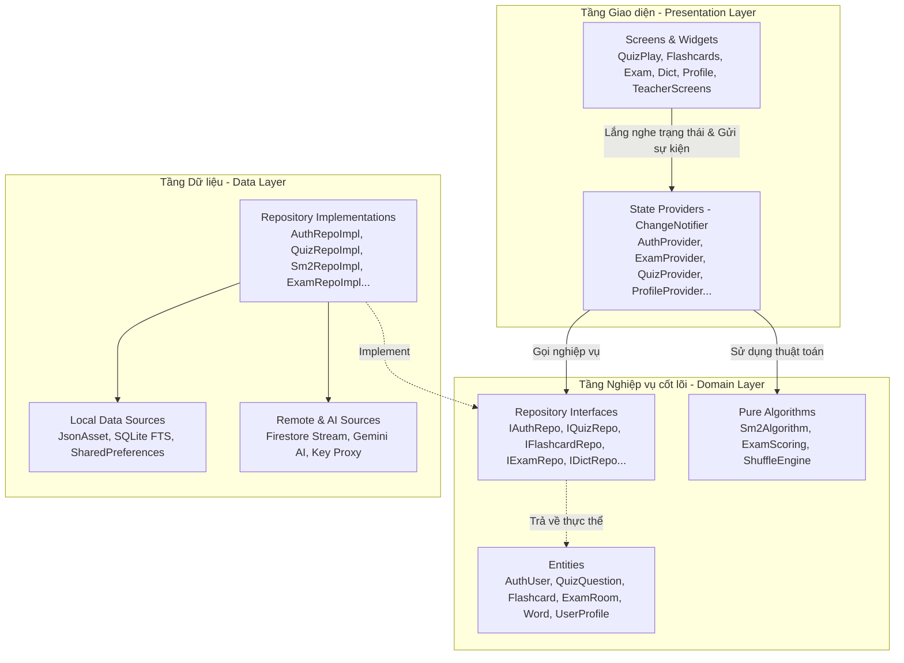

# 🏛️ BÁO CÁO TỔNG QUAN DỰ ÁN & THIẾT KẾ KIẾN TRÚC
## HỆ THỐNG SIÊU ỨNG DỤNG GIÁO DỤC & ÔN TẬP SONG NGỮ EDUMASTER

> **Học phần:** Phát triển ứng dụng cho các thiết bị di động (INT1449)  
> **Lớp:** INT1449-20261-02  
> **Đơn vị đào tạo:** Học viện Công nghệ Bưu chính Viễn thông (PTIT)  
> **Nhóm thực hiện:** Nhóm F (Chủ đề: 32, 34, 35, 36 kết hợp 33)  
> - Bùi Phương Ngọc — B24DCCC215  
> - Nguyễn Minh Phương — B24DCCC231  
> - Nguyễn Thị Yến Vi — B24DCCC286  
> **Nền tảng:** Flutter SDK (Dart 3.x), Android Cross-Platform, Clean Architecture  
> **Mục tiêu đánh giá:** Đạt mức **Xuất sắc (100%)** trên tất cả 7 tiêu chí thẩm định.

---

## 1. GIỚI THIỆU TỔNG QUAN & HỆ THỐNG VAI TRÒ DỰ ÁN

EduMaster là một siêu ứng dụng học tập và thi cử toàn diện tích hợp trí tuệ nhân tạo (AI Tutor) và Camera. Ứng dụng xây dựng **Hệ thống Phân quyền 2 Chế độ Độc lập (Giáo viên ↔ Sinh viên)**, giúp đáp ứng linh hoạt nhu cầu của cả giảng viên và người học:

### 1.1. Luồng Giảng viên (Teacher Flow):
1. **Tạo & Quản lý phòng thi (`ExamHubScreen`)**: Đặt tiêu đề, mã PIN, thời gian thi và chọn nguồn câu hỏi (Bộ đề chuẩn, Lọc ngân hàng 300 câu, Tự soạn câu hỏi tùy chỉnh). Sinh mã QR phòng thi.
2. **Chi tiết & Giám sát phòng thi (`TeacherRoomDetailScreen`)**:
   - **Giám sát trực tiếp (Realtime Live Monitor)**: Theo dõi tiến độ làm bài sinh viên (câu hiện tại, số câu khoanh, số câu đúng), phát hiện vi phạm thoát/chuyển ứng dụng giữa giờ kèm mốc thời gian chi tiết.
   - **Biểu đồ Thống kê Điểm số (`Score Distribution Histogram Chart`)**: Trực quan hóa phân bố điểm số thang 10 (Kém <5.0, TB 5.0-6.9, Khá 7.0-8.4, Giỏi 8.5-10.0), tỉ lệ Đạt/Trượt.
   - **Mã QR & Bộ đề**: Mở lại mã QR và xem chi tiết danh sách câu hỏi.
3. **Lịch sử phòng thi đã tạo (`TeacherExamHistoryScreen`)**: Quản lý lịch sử các phòng thi đã tạo, mở lại báo cáo thống kê bất kỳ lúc nào.
4. **Quản lý Nhóm học tập & Đồng bộ thời gian thực (`LeaderboardScreen`)**: Tạo nhóm, đổi tên, xóa nhóm, thêm sinh viên bằng Mã ID hoặc Email sinh viên; tích hợp cơ chế Auto-Enrollment tự động ghi danh mới vào hệ thống và đồng bộ thời gian thực hai chiều.

### 1.2. Luồng Sinh viên (Student Flow):
1. **Ôn tập trắc nghiệm song ngữ 300 câu**: Chế độ Luyện tập tự do, Thi thử 20 phút, Làm lại câu sai, Lọc theo khối chủ đề.
2. **Flashcards SuperMemo SM-2**: Thẻ ghi nhớ ngắt quãng khoa học, lật thẻ 3D, nhập CSV, phát âm TTS.
3. **Phòng thi trực tuyến**: Nhập mã PIN hoặc **Quét mã QR bằng Camera** vào làm bài, hệ thống ghi nhận gian lận khi thoát app.
4. **Từ điển IT Offline (SQLite FTS)**: Tra cứu siêu tốc $O(\log N)$, Từ của ngày (Word of the Day), Bookmark.
5. **Bảng xếp hạng thi đua & Nhóm học tập Realtime**: Tích lũy XP, chuỗi ngày Streak, Huy hiệu thành tích (Badges), tự động hiển thị nhóm được GV phân công và thứ hạng thi đua.

---

## 2. THIẾT KẾ KIẾN TRÚC HỆ THỐNG (CLEAN ARCHITECTURE)

Dự án áp dụng chặt chẽ kiến trúc **Clean Architecture** kết hợp mô hình quản lý trạng thái **Provider (ChangeNotifier)**, đáp ứng trọn vẹn yêu cầu Tiêu chí 3:
* **Tách biệt hoàn toàn:** Tầng Giao diện (Presentation), Tầng Nghiệp vụ cốt lõi (Domain) và Tầng Dữ liệu (Data).
* **Nguyên lý Đảo ngược phụ thuộc (Dependency Inversion Principle - DIP):** Các Repository trong tầng Domain là các Interface trừu tượng (`abstract class`).
* **Tuyệt đối không gọi mạng hay I/O trong hàm `build()`**: Toàn bộ thao tác bất đồng bộ được quản lý trong Provider.
* **Giải phóng tài nguyên (Dispose):** 100% `TextEditingController`, `AnimationController`, `StreamSubscription`, `Timer`, `HttpClient` đều được giải phóng trong phương thức `dispose()`.



---

## 3. CƠ CẤU THƯ MỤC DỰ ÁN (PROJECT DIRECTORY STRUCTURE)

```text
lib/
├── core/                               # Tài nguyên dùng chung cốt lõi
│   ├── constants/                      # Hằng số màu sắc, chuỗi song ngữ
│   ├── errors/                         # Định nghĩa hệ thống lỗi phân cấp
│   ├── theme/                          # Cấu hình Theme Light/Dark chuẩn WCAG AA
│   └── widgets/                        # Widget giao diện chuẩn tái sử dụng (Loading, Error, Empty)
├── data/                               # Tầng Dữ liệu (Data Layer)
│   ├── datasources/                    # Nguồn dữ liệu vật lý (SQLite, SharedPreferences, JSON, Gemini AI)
│   └── repositories/                   # Triển khai Repository Interfaces
├── domain/                             # Tầng Nghiệp vụ thuần khiết (Domain Layer)
│   ├── algorithms/                     # Thuật toán thuần Dart (SM-2 Spaced Repetition)
│   ├── entities/                       # Các lớp mô hình dữ liệu bất biến (AuthUser, ExamRoom...)
│   └── repositories/                   # Khai báo Hợp đồng trừu tượng (Interfaces)
├── presentation/                       # Tầng Trình diễn (Presentation Layer)
│   ├── providers/                      # Quản lý trạng thái bằng Provider (ChangeNotifier)
│   └── screens/                        # Màn hình người dùng (Auth, Teacher, Student, AI Tutor...)
└── main.dart                           # Khởi tạo DI, cấu hình hệ thống & chạy App
```
