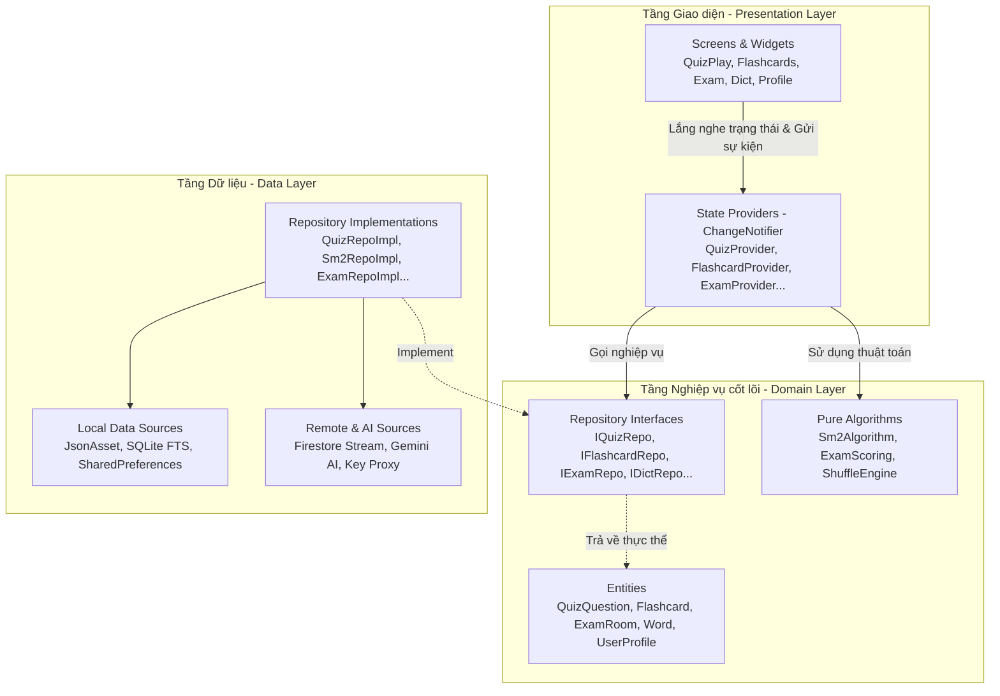

# 🏛️ BÁO CÁO TỔNG QUAN DỰ ÁN & THIẾT KẾ KIẾN TRÚC
## HỆ THỐNG SIÊU ỨNG DỤNG GIÁO DỤC & ÔN TẬP SONG NGỮ EDUMASTER

> **Học phần:** Lập trình Thiết bị Di động (Mobile Application Development - INT1449)  
> **Đơn vị đào tạo:** Khoa Công nghệ Thông tin — Trường Đại học Phenikaa  
> **Nhóm thực hiện:** Nhóm F — Giáo dục và Ôn tập  
> **Nền tảng:** Flutter SDK (Dart 3.x), Android / iOS Cross-Platform, Clean Architecture  
> **Mục tiêu đánh giá:** Đạt mức **Xuất sắc (100%)** trên tất cả 7 tiêu chí thẩm định.

---

## 1. GIỚI THIỆU TỔNG QUAN

EduMaster là một giải pháp siêu ứng dụng học tập và ôn luyện toàn diện, tích hợp trí tuệ nhân tạo (AI Tutor) và công nghệ Camera thực tế. Ứng dụng giải quyết bài toán ôn thi trắc nghiệm song ngữ, ghi nhớ kiến thức dài hạn bằng thuật toán khoa học SuperMemo SM-2, tổ chức thi trực tuyến minh bạch chống gian lận, tra cứu thuật ngữ CNTT ngoại tuyến và thi đua học tập thời gian thực.

### Danh mục phân hệ tích hợp:
1. **Phân hệ #32:** Ôn tập trắc nghiệm song ngữ Anh - Việt với ngân hàng 300 câu hỏi chuẩn hóa kèm giải thích chi tiết.
2. **Phân hệ #33:** Thẻ ghi nhớ lặp lại ngắt quãng (Spaced Repetition) ứng dụng thuật toán SuperMemo SM-2, lật thẻ 3D và phát âm Text-To-Speech.
3. **Phân hệ #34:** Phòng thi trực tuyến nhỏ chống gian lận với bộ đếm giờ, đảo đề ngẫu nhiên và mã QR phòng thi.
4. **Phân hệ #35:** Từ điển thuật ngữ CNTT Anh - Việt ngoại tuyến với công nghệ tìm kiếm siêu tốc SQLite FTS.
5. **Phân hệ #36:** Bảng xếp hạng học tập thời gian thực (Realtime Leaderboard & Badges).
6. **Phân hệ Camera & AI:** Quét mã QR phòng thi siêu tốc bằng `mobile_scanner`, chụp ảnh đại diện `image_picker` và Gia sư ảo đa tầng (Chế độ Demo, Key Proxy Server, Gemini API).

---

## 2. THIẾT KẾ KIẾN TRÚC HỆ THỐNG (CLEAN ARCHITECTURE)

Dự án áp dụng chặt chẽ kiến trúc **Clean Architecture** kết hợp mô hình quản lý trạng thái **Provider (ChangeNotifier)**, đáp ứng trọn vẹn yêu cầu Tiêu chí 3 của đề bài:
* **Tách biệt hoàn toàn:** Tầng Giao diện (Presentation), Tầng Nghiệp vụ cốt lõi (Domain) và Tầng Dữ liệu (Data).
* **Nguyên lý Đảo ngược phụ thuộc (Dependency Inversion Principle - DIP):** Các Repository trong tầng Domain là các Interface trừu tượng (`abstract class`). Tầng Presentation phụ thuộc vào Interface, không phụ thuộc vào triển khai cụ thể (dễ dàng thay thế bằng Mock Data / Đồ giả khi chạy Test).
* **Tuyệt đối không gọi mạng hay I/O trong hàm `build()`**: Toàn bộ thao tác bất đồng bộ được quản lý trong Provider và khởi tạo tại `initState()` hoặc qua sự kiện người dùng.
* **Giải phóng tài nguyên (Dispose):** 100% `TextEditingController`, `AnimationController`, `StreamController`, `Timer`, `HttpClient` đều được giải phóng trong phương thức `dispose()`.

### Sơ đồ phân tầng kiến trúc (Clean Architecture):



---

## 3. CƠ CẤU THƯ MỤC DỰ ÁN (PROJECT DIRECTORY STRUCTURE)

```text
lib/
├── core/                               # Tài nguyên dùng chung cốt lõi
│   ├── constants/                      # Hằng số màu sắc, chuỗi song ngữ, cấu hình
│   │   ├── app_colors.dart             # Bảng màu chuẩn Material 3
│   │   └── app_strings.dart            # Chuỗi giao diện song ngữ, hằng số kích thước >= 48dp
│   ├── errors/                         # Định nghĩa hệ thống lỗi phân cấp
│   │   └── app_exception.dart          # AppException, NetworkTimeoutException, StorageException
│   ├── theme/                          # Cấu hình Theme Light/Dark chuẩn WCAG AA
│   │   └── app_theme.dart              # ThemeData, CardThemeData, InputTheme
│   └── widgets/                        # Widget giao diện chuẩn tái sử dụng
│       └── state_views.dart            # LoadingView, ErrorViewWithRetry, EmptyStateView
├── data/                               # Tầng Dữ liệu (Data Layer)
│   ├── datasources/                    # Nguồn dữ liệu vật lý
│   │   ├── quiz_local_datasource.dart       # Nạp 300 câu hỏi JSON asset
│   │   ├── sm2_storage_datasource.dart     # Lưu trữ Flashcard SharedPreferences an toàn
│   │   ├── exam_storage_datasource.dart    # Lưu trữ phòng thi và lịch sử làm bài
│   │   ├── dictionary_sqlite_datasource.dart # SQLite Full-Text Search FTS3/4
│   │   ├── leaderboard_datasource.dart     # Firestore / Realtime Stream mô phỏng
│   │   └── gemini_ai_datasource.dart       # AI đa tầng: Demo Mode, Key Proxy, Gemini API
│   └── repositories/                   # Triển khai Repository Interfaces
│       ├── quiz_repository_impl.dart
│       ├── flashcard_repository_impl.dart
│       ├── exam_repository_impl.dart
│       ├── dictionary_repository_impl.dart
│       ├── leaderboard_repository_impl.dart
│       └── ai_tutor_repository_impl.dart
├── domain/                             # Tầng Nghiệp vụ thuần khiết (Domain Layer)
│   ├── algorithms/                     # Thuật toán thuần Dart (Dễ dàng Unit Test độc lập)
│   │   └── sm2_algorithm.dart          # Thuật toán SuperMemo SM-2 chuẩn hóa
│   ├── entities/                       # Các lớp mô hình dữ liệu bất biến (Immutable)
│   │   ├── quiz_question.dart
│   │   ├── flashcard.dart
│   │   ├── exam.dart
│   │   ├── dictionary_word.dart
│   │   └── leaderboard_entry.dart
│   └── repositories/                   # Khai báo Hợp đồng trừu tượng (Interfaces)
│       └── interfaces.dart
├── presentation/                       # Tầng Trình diễn (Presentation Layer)
│   ├── providers/                      # Quản lý trạng thái bằng Provider (ChangeNotifier)
│   │   ├── quiz_provider.dart
│   │   ├── flashcard_provider.dart
│   │   ├── exam_provider.dart
│   │   ├── dictionary_provider.dart
│   │   ├── leaderboard_provider.dart
│   │   ├── ai_tutor_provider.dart
│   │   └── profile_provider.dart
│   └── screens/                        # Các màn hình người dùng
│       ├── main_navigation_screen.dart # Thanh điều hướng 5 tab mượt mà
│       ├── quiz/                       # Màn hình Hub, Thi thử, Làm lại câu sai, Kết quả
│       ├── flashcards/                 # Danh sách Deck, Học thẻ lật 3D, Nhập CSV
│       ├── online_exam/                # Tạo phòng thi, Vào phòng bằng mã PIN, Làm bài thi
│       ├── dictionary/                 # Tra cứu FTS tức thì, Phát âm TTS, Từ của ngày
│       ├── leaderboard/                # Bảng vàng xếp hạng, Huy hiệu thành tích
│       ├── scanner/                    # Quét mã QR bằng Camera siêu tốc
│       ├── ai_tutor/                   # Trò chuyện với Trợ lý ảo AI Tutor 24/7
│       └── profile/                    # Hồ sơ học viên, Đổi Avatar Camera, Cấu hình AI
└── main.dart                           # Khởi tạo DI, cấu hình hệ thống & chạy App
```

---

## 4. QUẢN LÝ VÒNG ĐỜI VÀ TRẠNG THÁI GIAO DIỆN (UI STATES)

Đáp ứng đầy đủ **Tiêu chí 2 (Giao diện và trải nghiệm - 15 điểm)**:
1. **Trạng thái Đang tải (`LoadingView`):** Luôn hiển thị thanh tiến trình rõ ràng kèm thông điệp nghiệp vụ và nút *"Hủy bỏ"* có lối ra, không bao giờ để màn hình bị treo trắng.
2. **Trạng thái Bị lỗi (`ErrorViewWithRetry`):** Khi xảy ra lỗi mạng hoặc timeout, hiển thị thông báo lỗi thân thiện kèm 2 nút lối ra: *"Thử lại"* và *"Quay lại"*.
3. **Trạng thái Chưa có dữ liệu (`EmptyStateView`):** Khi danh sách câu sai hoặc bộ thẻ trống, hiển thị hình ảnh minh họa cùng nút hành động định hướng người dùng.
4. **Vùng chạm chuẩn trợ năng ($\ge 48\text{ dp}$):** Toàn bộ các nút bấm, ô check, icon tương tác đều được bao bọc bởi `TouchTargetWrapper` hoặc cấu hình `minInteractiveDimension = 48.0`.
