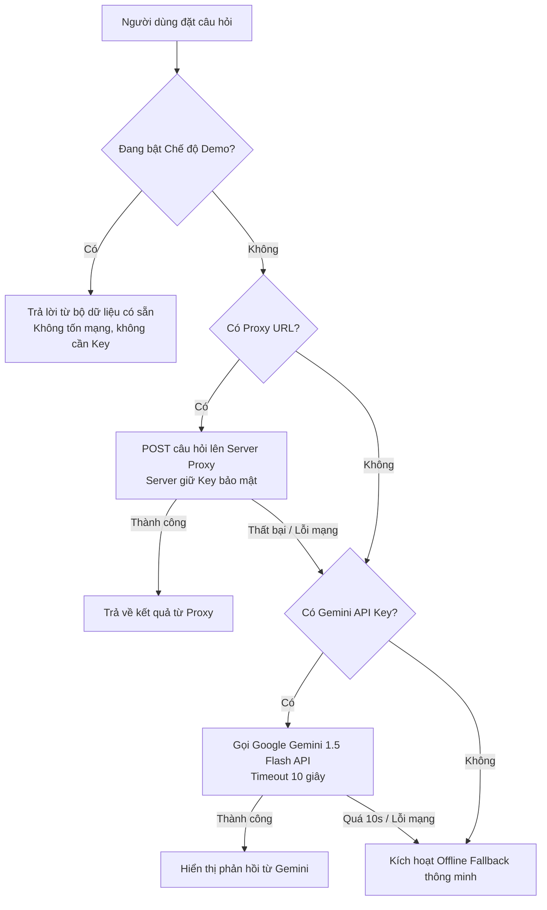

# ⚙️ ĐẶC TẢ CHI TIẾT TÍNH NĂNG & THUẬT TOÁN HỆ THỐNG
## EDUMASTER — DỰ ÁN BÀI TẬP LỚN (BTL_KTHP)

---

## 1. PHÂN HỆ #32: ÔN TẬP TRẮC NGHIỆM SONG NGỮ

### 1.1. Nguồn dữ liệu thực tế
* Toàn bộ 300 câu hỏi được trích xuất và chuẩn hóa từ 2 tệp tài liệu chính thức:
  * `Trac_nghiem_Flutter_300_cau_song_ngu (1).docx`
  * `Trac_nghiem_Flutter_300_cau_song_ngu - Lời giải.docx`
* Cấu trúc mỗi câu hỏi bao gồm:
  * Câu hỏi Tiếng Việt (`questionVi`) & Tiếng Anh (`questionEn`).
  * 4 lựa chọn Tiếng Việt (`optionsVi`) & Tiếng Anh (`optionsEn`).
  * Vị trí đáp án đúng (`correctIndex` từ 0 đến 3).
  * Lời giải thích chuyên sâu song ngữ (`explanationVi`, `explanationEn`).
  * Khối chủ đề (`grade`: từ Khối 1 đến Khối 20) và liên kết tài liệu tham khảo chính thức (`sourceUrl`).

### 1.2. Các tính năng cốt lõi & Mở rộng
* **Tính năng tối thiểu:**
  * Nạp và hiển thị toàn bộ 300 câu từ file `assets/data/questions_300.json`.
  * **Chế độ Luyện tập tự do:** Hiển thị kết quả đúng/sai ngay lập tức sau khi chọn, hiện giải thích chi tiết.
  * **Chế độ Thi thử:** Tạo đề thi ngẫu nhiên 20 câu, tính điểm trên thang điểm 10.
  * **Làm lại câu sai (Review Mistake Mode):** Tự động lưu vết danh sách các câu trả lời sai vào bộ nhớ cục bộ, cho phép học sinh ôn tập lại riêng các câu này cho đến khi thuần thục.
* **Mở rộng 1 (Song ngữ động):** Nút chuyển đổi tức thời giữa giao diện Tiếng Việt $\leftrightarrow$ Tiếng Anh ngay trong lúc làm bài mà không làm mất trạng thái câu hỏi hiện tại.
* **Mở rộng 2 (Đồng hồ đếm ngược):** Bộ đếm ngược 20 phút với cơ chế cảnh báo khi sắp hết giờ và tự động thu bài khi đồng hồ điểm 00:00.
* **Đột phá AI Tutor:** Khi chọn sai, xuất hiện nút *"Hỏi AI lý do sai"*. AI phân tích câu hỏi, đáp án bạn đã chọn và đáp án đúng để đưa ra lời khuyên khắc phục.

---

## 2. PHÂN HỆ #33: THẺ GHI NHỚ LẶP LẠI NGẮT QUÃNG (SUPERMEMO SM-2)

### 2.1. Cơ sở toán học của thuật toán SuperMemo SM-2
Thuật toán SuperMemo SM-2 tính toán thời điểm lặp lại tối ưu dựa trên đường cong lãng quên (Forgetting Curve) của Ebbinghaus, sử dụng 3 tham số trạng thái:
1. **$n$ (Repetition count):** Số lần ôn tập liên tiếp thành công.
2. **$EF$ (Ease Factor):** Hệ số độ dễ của thẻ, giá trị khởi tạo $EF = 2.5$, giá trị chặn dưới $EF \ge 1.3$.
3. **$I$ (Interval):** Khoảng cách số ngày cần ôn tập tiếp theo.

#### Công thức cập nhật:
Khi người dùng đánh giá chất lượng ghi nhớ $q$ từ $0$ đến $5$ (với $q \ge 3$ là nhớ thành công, $q < 3$ là quên):

$$\Delta EF = 0.1 - (5 - q) \times (0.08 + (5 - q) \times 0.02)$$

$$EF' = \max(1.3, EF + \Delta EF)$$

Khoảng cách ngày ôn tập tiếp theo $I(n)$:

$$I(n) = \begin{cases} 1 & \text{khi } n = 1 \\ 6 & \text{khi } n = 2 \\ \text{round}(I(n-1) \times EF') & \text{khi } n > 2 \end{cases}$$

* **Khi người dùng quên ($q < 3$):** Thẻ bị reset $n = 0$ và $I = 1$ (phải ôn lại ngay vào ngày hôm sau).

### 2.2. Tính năng mở rộng
* **Nhập thẻ hàng loạt từ CSV:** Hỗ trợ nhập dữ liệu theo định dạng `Thuật ngữ, Định nghĩa` giúp giáo viên dễ dàng bổ sung học liệu.
* **Hoạt ảnh lật thẻ 3D:** Sử dụng `Transform` với ma trận xoay `Matrix4.identity()..rotateY(angle)` tạo hiệu ứng lật thẻ 2 mặt sinh động, trực quan.
* **Phát âm chuẩn Text-To-Speech (TTS):** Đọc to câu hỏi/đáp án bằng giọng đọc tiếng Anh bản ngữ.

---

## 3. PHÂN HỆ #34: PHÒNG THI TRỰC TUYẾN CHỐNG GIAN LẬN

### 3.1. Tính năng cốt lõi
* **Tạo đề & Quản lý phòng thi:** Giảng viên/Nhóm trưởng đặt tên phòng thi, thiết lập thời gian làm bài (phút), số lượng câu hỏi và sinh mã PIN định danh (ví dụ `EXAM100`).
* **Cơ chế chống gian lận (Anti-Cheating Lifecycle Listener):**
  * Ứng dụng lắng nghe trạng thái ứng dụng qua `WidgetsBindingObserver.didChangeAppLifecycleState`.
  * Nếu thí sinh chuyển tab, thu nhỏ ứng dụng hoặc mở ứng dụng khác (`AppLifecycleState.paused` hoặc `inactive`), hệ thống ghi nhận ngay lập tức một lần vi phạm rời ứng dụng và hiển thị cảnh báo đỏ trên bài thi.
* **Chấm điểm tự động:** Tính điểm tức thời theo công thức chuẩn:
  $$\text{Điểm} = \left(\frac{\text{Số câu đúng}}{\text{Tổng số câu}}\right) \times 10$$

### 3.2. Tính năng mở rộng
* **Xáo trộn câu hỏi và đáp án ngẫu nhiên (Fisher-Yates Shuffle):** Mỗi thí sinh vào phòng thi sẽ nhận được thứ tự câu hỏi và thứ tự các lựa chọn A, B, C, D hoàn toàn khác nhau, ngăn chặn triệt để hành vi quay cóp.
* **Tích hợp Camera QR:** Giảng viên sinh mã QR phòng thi; thí sinh chỉ cần bật Camera quét mã là vào thẳng phòng thi trong 1 giây mà không cần gõ mã PIN thủ công.

---

## 4. PHÂN HỆ #35: TỪ ĐIỂN THUẬT NGỮ IT ANH - VIỆT OFFLINE

### 4.1. Công nghệ cơ sở dữ liệu SQLite FTS
* Ứng dụng triển khai bảng ảo **FTS (Full-Text Search)** trong SQLite thay vì truy vấn `LIKE '%query%'` thông thường.
* **Ưu điểm vượt trội:**
  * Tốc độ tìm kiếm đạt độ phức tạp $O(\log N)$, phản hồi kết quả gần như tức thời ($< 5\text{ms}$) ngay cả khi dữ liệu lên đến hàng chục nghìn từ.
  * Tự động tạo chỉ mục đảo (Inverted Index) trên cả cột thuật ngữ tiếng Anh và định nghĩa tiếng Việt.

### 4.2. Tính năng tiện ích
* **Đánh dấu từ yêu thích (Bookmark):** Lưu trữ danh sách thuật ngữ quan trọng để ôn tập nhanh.
* **Phát âm TTS:** Hỗ trợ phát âm chuẩn quốc tế các thuật ngữ kỹ thuật khó.
* **Từ của ngày (Word of the Day):** Tự động chọn ngẫu nhiên một thuật ngữ hay dựa trên chu kỳ ngày tháng (`seed = DateTime.now().day`) hiển thị ngay tại trang chủ từ điển.
* **Hoạt động 100% ngoại tuyến:** Toàn bộ cơ sở dữ liệu nằm trong sandbox ứng dụng, không đòi hỏi kết nối mạng.

---

## 5. PHÂN HỆ #36: BẢNG XẾP HẠNG THI ĐUA THỜI GIAN THỰC

### 5.1. Cơ chế Realtime Stream & Gamification
* Hệ thống mô phỏng kiến trúc Firestore Realtime qua Dart `Stream<List<LeaderboardEntry>>`. Khi có thành viên hoàn thành bài thi hoặc ôn flashcard, điểm số tự động nhảy thời gian thực trên màn hình của tất cả thành viên trong nhóm.
* **Hệ thống điểm kinh nghiệm (XP):**
  * Làm đúng 1 câu trắc nghiệm: $+10\text{ XP}$.
  * Ôn tập 1 thẻ flashcard: $+5\text{ XP}$.
  * Hoàn thành bài thi đạt điểm $\ge 8.0$: $+50\text{ XP}$.
* **Chuỗi ngày học tập (Streak Days):** Ghi nhận liên tục số ngày mở ứng dụng học bài.

### 5.2. Hệ thống Huy hiệu vinh danh (Badges)
* 🏅 **Tân binh Chăm chỉ:** Đạt chuỗi 3 ngày liên tiếp.
* ⚡ **Chiến binh Tốc độ:** Hoàn thành bài thi dưới 5 phút với điểm tuyệt đối.
* 🧠 **Bậc thầy Trí nhớ:** Ôn tập trên 50 thẻ flashcard với hệ số $EF \ge 2.5$.
* 👑 **Học bá Toàn năng:** Đứng Top 1 Bảng xếp hạng tuần.

---

## 6. PHÂN HỆ CAMERA & AI TUTOR ĐA TẦNG

